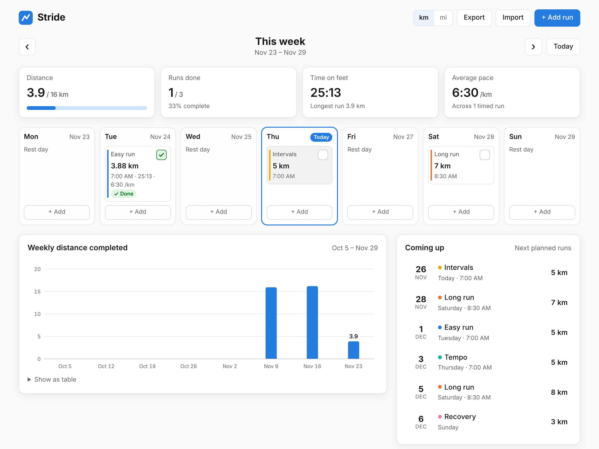

<div align="center">

# 🏃 Stride

**A simple, private running schedule tracker that lives in your browser.**

Plan your week, tick off runs as you go, and watch your distance build up.

<picture>
  <source media="(prefers-color-scheme: dark)" srcset="docs/screenshot-dark.png">
  
</picture>

</div>

---

## Why Stride?

Most running apps want an account, a subscription or a GPS watch. Stride doesn't. It's one web page you open to plan your training and record how it went.

- **No sign-up.** Open it and start planning.
- **Private.** Your runs are stored in your own browser and never leave your device.
- **Works anywhere.** Desktop or phone, light mode or dark.
- **Nothing to install.** It's three plain files: HTML, CSS and JavaScript.

## What you can do

| | |
|---|---|
| 📅 **Plan your week** | A Monday-to-Sunday view of every run, with today highlighted. Add a run to any day in a couple of clicks. |
| 🏷️ **Mix your training** | Easy runs, long runs, tempo, intervals, recovery and races, each with its own colour. |
| ✅ **Log as you go** | Tick a run to mark it done. Open it to add actual distance, time and notes, and Stride works out your pace. |
| 🔁 **Repeat weekly** | Schedule a regular run for 2–16 weeks in one go. |
| 📊 **See your progress** | Weekly totals for distance, runs done, time on feet and average pace, plus a chart of the last 8 weeks. |
| ⏭️ **Know what's next** | A "Coming up" list of your next planned runs. |
| 📏 **km or miles** | Switch units at any time. |
| 💾 **Back up your data** | Export your runs to a file and import them on another device. |

## Getting started

1. **Open Stride.** Open `index.html` in any modern browser, or use the hosted version if GitHub Pages is turned on for this repository.
2. **Plan a week.** Click **+ Add run**, or **+ Add** under a day. New here? Click **Load sample plan** for a beginner 10K plan you can edit.
3. **Go run.** 👟
4. **Tick it off.** Mark the run as done, and open it if you want to add your time and notes.

### Keyboard shortcuts

| Key | Action |
|---|---|
| `N` | Add a new run |
| `T` | Jump to this week |
| `←` / `→` | Previous / next week |

## Running it yourself

There is nothing to build. Serve the folder with any static file server:

```sh
python3 -m http.server 8000
# then visit http://localhost:8000
```

To publish it for free, go to **Settings → Pages** in this repository, choose **Deploy from a branch**, then pick the `stride` branch and the root folder.

## About your data

Stride saves your runs in your browser's `localStorage`, so:

- your data stays on the device and browser you used;
- clearing your browser data deletes it;
- using **Export** every so often gives you a backup you can **Import** later.

## Project structure

```
index.html   page layout and the add/edit dialog
styles.css   styling, light and dark themes
app.js       planner, stats, chart, storage, import/export
docs/        screenshots used in this README
```

---

<div align="center">
Happy running! 🏃‍♀️🏃‍♂️
</div>
